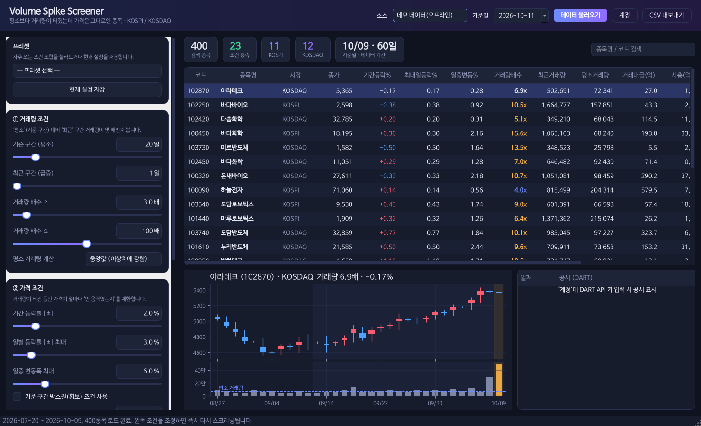

# PCB_LT_Analyzer — Volume Spike Screener

평소보다 **거래량이 터졌는데 가격은 거의 움직이지 않은** 종목을 KOSPI / KOSDAQ 에서 찾는 데스크톱 GUI 입니다.
거래량 배수와 가격 허용 범위를 슬라이더로 조정하면 결과가 즉시 다시 계산됩니다.

- 시세: KRX 정보데이터시스템 (KRX 계정 로그인, [pykrx](https://github.com/sharebook-kr/pykrx) 사용)
- 수급: 외국인 · 기관 순매수 조건 (최근 1~10영업일 순매수 금액·순매수일 수)
- 공시: OpenDART API (선택 종목의 최근 90일 공시, 위험/호재 공시 색상 표시)
- 계정: KRX / DART 계정·비밀번호·API 인증키를 **계정 비밀번호로 암호화**해 저장
- 다른 상승 후보 스크리닝 방법 검토: [`docs/screening_strategies_review.md`](docs/screening_strategies_review.md)



## 실행파일(.exe)로 쓰기

| 방법 | 설명 |
|---|---|
| GitHub Actions | 브랜치에 push 하면 **Build executable** 워크플로가 Windows 용 `VolumeSpikeScreener.exe` 를 만들어 *Artifacts* 에 올립니다. (Actions 탭 → 실행 → `VolumeSpikeScreener-windows` 다운로드) |
| 직접 빌드 (Windows) | `build_exe.bat` 더블클릭 → `dist\VolumeSpikeScreener.exe` |
| 직접 빌드 (공통) | `pip install -r requirements.txt pyinstaller` 후 `python build_exe.py` |

exe 하나로 동작하며 Python 설치가 필요 없습니다. 시세 DB(`stock_data.db`)는 exe 와 같은 폴더에,
계정 금고·로그는 `%APPDATA%\VolumeSpikeScreener\` 에 저장됩니다.

## 파이썬으로 실행 (가장 간단)

1. [Python 3.10 이상](https://www.python.org/downloads/) 설치 — Windows 는 설치 첫 화면에서 **Add python.exe to PATH** 체크
2. 이 폴더(또는 zip 압축 해제한 폴더)에서
   - Windows: **`run_windows.bat` 더블클릭**
   - Mac/Linux: 터미널에서 `./run_mac_linux.sh`
3. 처음 한 번은 필요한 패키지를 자동 설치합니다(수 분). 이후에는 바로 실행됩니다.
4. 데이터 없이 화면만 보려면 `run_windows.bat --demo` / `./run_mac_linux.sh --demo`

### 파일 하나로 실행 · 수정 (`volume_spike_screener.py`)

다른 PC 에서 검증하거나 직접 고칠 때는 **`volume_spike_screener.py` 파일 하나만** 복사하면 됩니다.

```bash
pip install pandas numpy requests pykrx PySide6 matplotlib cryptography
python volume_spike_screener.py --demo     # 데모
python volume_spike_screener.py            # KRX 실데이터
```

이 파일은 `screener/` 패키지를 `python tools/build_single_py.py` 로 합친 배포본입니다.
파일 안의 `# ====` 구분선 아래에 원래 모듈 경로가 적혀 있습니다.
(패키지를 고친 뒤에는 다시 생성해야 하며, 테스트가 불일치를 잡아냅니다.)

### 직접 명령으로 실행

```bash
pip install -r requirements.txt
python run_screener.py          # KRX 실데이터
python run_screener.py --demo   # 계정/네트워크 없이 합성 데이터로 UI 확인
```

## 계정 · 비밀번호

1. 상단 **계정** 버튼 → 계정 비밀번호 입력. **초기 비밀번호는 `0000`** 입니다.
2. `0000` 으로 처음 접속하면 **새 비밀번호 설정 화면이 강제로 뜹니다** (4자 이상, 0000 불가). 변경하지 않으면 계정 화면에 들어갈 수 없습니다.
3. 계정 화면에서 KRX ID/비밀번호, DART ID/비밀번호, **DART API 인증키**를 입력 → 저장.
4. 계정 화면의 **계정 비밀번호 변경** 버튼으로 언제든 변경 (현재 비밀번호 확인 필요).
5. 계정 화면은 들어갈 때마다 비밀번호를 묻습니다. KRX 데이터 불러오기는 실행 중 한 번만 잠금 해제하면 됩니다.
6. 비밀번호 5회 오류 시 30초 잠금. 잊은 경우 *비밀번호를 잊었어요(초기화)* → 저장된 계정 정보가 삭제되고 0000 으로 돌아갑니다.

저장 방식: 계정 비밀번호 → PBKDF2-SHA256(60만 회) 키 유도 → Fernet(AES) 암호화. 디스크에 평문 비밀번호는 남지 않습니다.

> **DART 는 ID/PW 가 아니라 API 인증키로 조회합니다.** opendart.fss.or.kr 로그인 → *인증키 신청/관리* 에서 40자리 키를 발급받아 넣으세요. (DART ID/PW 는 보관용으로만 저장)

## 화면 구성

| 영역 | 내용 |
|---|---|
| 상단 | 데이터 소스(KRX/데모), 기준일, 데이터 불러오기, 계정(비밀번호 잠금), DB(위치·상태), 결과 DB 저장, CSV 내보내기 |
| 왼쪽 | 조건 카드 — ① 거래량 ② 가격 ③ 유동성·규모 ④ 시장·제외 ⑤ 수급(외국인·기관), 프리셋 저장/불러오기 |
| 가운데 | 결과 요약 칩, 종목 검색, 결과 테이블(컬럼 클릭 정렬, 더블클릭 → 네이버 금융) |
| 아래 | 선택 종목 캔들+거래량 차트(파랑 음영=평소 구간, 주황=급증 구간), DART 공시 목록 |

## 조건 정의

```
[ ...... 기준 구간(평소) base_days ...... ][ 최근 구간 recent_days ]
                                        ↑ 직전 종가 = 등락률 기준점        ↑ 기준일
```

| 파라미터 | 의미 | 기본값 |
|---|---|---|
| 기준 구간 | 평소 거래량을 계산하는 과거 영업일 수 (중앙값/평균 선택) | 20일, 중앙값 |
| 최근 구간 | 거래량 급증을 확인할 영업일 수 | 1일 |
| 거래량 배수 | 최근 구간 평균 거래량 ÷ 평소 거래량 | ≥ 3배 |
| 기간 등락률 | 최근 구간 직전 종가 대비 기준일 종가 | ±2% 이내 |
| 일별 등락률 | 최근 구간 각 날짜 등락률 절대값 최대 | 3% 이내 |
| 일중 변동폭 | (고가−저가)/전일종가 최대 | 6% 이내 |
| 박스권(선택) | 기준 구간 (최고−최저 종가)/평균 | 15% 이내 |
| 유동성 | 최근 평균 거래대금, 주가, 시가총액 범위 | 5억↑, 1,000원↑ |
| 제외 | 우선주, 스팩, 최근 구간 거래정지 종목 | 제외 |
| 수급 사용 | 외국인·기관 순매수 조건 켜기 | 꺼짐 |
| 수급 방식 | 외국인+기관 모두 / 외국인 또는 기관 / 외국인 / 기관 / 외국인+기관 합산 | 외국인 또는 기관 |
| 수급 집계 기간 | 기준일 포함 최근 N 영업일 (1~10) | 3일 |
| 순매수 금액 | 기간 순매수 합계 하한 (억원, 0 = 순매수이기만 하면 통과) | 0억 |
| 순매수한 날 | 기간 중 순매수(+)였던 날 수 하한 | 1일 |

점수 = `log2(거래량배수) × 10 / (1 + |기간등락률| + 0.5 × 일중변동폭)` — 거래량이 클수록, 가격이 덜 움직일수록 높음.

## 데이터 저장 (DB)

받아온 데이터는 **SQLite DB 파일 하나**(`stock_data.db`)에 쌓입니다.

| 항목 | 내용 |
|---|---|
| 기본 위치 | 프로그램 폴더 (`run_screener.py` 가 있는 폴더, exe 는 exe 가 있는 폴더) |
| 위치 변경 | 상단 **DB** 버튼 → 위치 변경 (기존 .db 파일을 고르면 그 DB 사용) |
| 저장 내용 | 일별 전종목 시세, 외국인·기관 순매수, 시가총액, 종목명, **저장한 스크리닝 결과** |
| 다시 받는 것 | 아직 DB 에 없는 날짜만. 오늘 데이터는 18시 이전엔 장중 값이므로 매번 새로 받고, 18시 이후 확정 저장 |
| 결과 저장 | 상단 **결과 DB 저장** → 기준일 · 조건 · 종목별 지표 기록 (같은 기준일·조건은 덮어씀) |
| 열어보기 | [DB Browser for SQLite](https://sqlitebrowser.org/) 또는 `pandas.read_sql` |

처음 실행은 약 60영업일 × 2시장 ≈ 120회 + 순매수 40회를 받느라 수 분 걸리고,
다음부터는 새 날짜분(하루 약 6~10회)만 받습니다. 예전 버전의 `.pkl` 캐시가 있으면 처음 실행 때 DB 로 옮깁니다.
순매수 수집이 실패해도 시세 스크리닝은 그대로 동작하며, 수급 조건 카드에 경고가 표시됩니다.
조건 슬라이더 조정은 네트워크 호출 없이 메모리에서만 다시 계산합니다.

## 테스트

```bash
python -m pytest -q
```

## 구조

```
run_screener.py            # 실행 진입점 (--demo, --selftest)
volume_spike_screener.py   # 단일 파일 배포본 (tools/build_single_py.py 로 생성)
build_exe.py / build_exe.bat   # PyInstaller 실행파일 빌드
screener/core.py           # 스크리닝 로직 (pandas, GUI 독립) — 거래량/가격/수급 조건
screener/vault.py          # 계정 정보 암호화 금고 (초기 비밀번호 0000)
screener/db.py             # SQLite DB (시세·수급·스크리닝 결과 저장)
screener/paths.py          # 사용자 데이터 폴더 (계정 금고·로그)
screener/data/krx.py       # KRX 로그인 + 시세 패널 수집/캐시
screener/data/dart.py      # OpenDART 공시 조회·분류
screener/data/demo.py      # 오프라인 합성 데이터
screener/gui/              # PySide6 GUI (테마, 위젯, 차트, 테이블 모델, 워커, 계정 화면)
docs/screening_strategies_review.md   # 추가 스크리닝 방법 검토
```

> 본 도구는 종목 후보를 찾는 보조 도구이며 매수/매도 추천이 아닙니다. 자동 주문 기능은 포함하지 않습니다.
